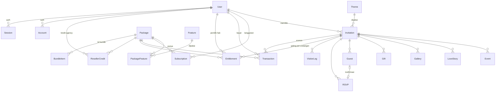

# IKARA — Platform Undangan Pernikahan Digital (SaaS)

IKARA adalah aplikasi **SaaS undangan pernikahan digital**: pengguna membuat
undangan online (tema, acara, galeri, cerita, amplop digital), membagikannya
lewat URL/slug personal, mengelola tamu & RSVP, dan memonetisasi lewat paket
(eceran, langganan, reseller). Dibangun dengan **Next.js (App Router)** dan
**PostgreSQL (Prisma)**.

> 📚 Indeks dokumentasi lengkap: [`docs/`](docs/README.md) · Modul monetisasi: [`docs/packet-bundling-management.md`](docs/packet-bundling-management.md).

---

## Daftar Isi
1. [Tentang Project](#1-tentang-project)
2. [Tech Stack](#2-tech-stack)
3. [Arsitektur](#3-arsitektur)
4. [Struktur Folder](#4-struktur-folder)
5. [Database & ERD](#5-database--erd)
6. [Modul (Features)](#6-modul-features)
7. [Routing & Halaman](#7-routing--halaman)
8. [API Endpoints](#8-api-endpoints)
9. [Server Actions](#9-server-actions)
10. [Autentikasi & RBAC](#10-autentikasi--rbac)
11. [Integrasi Eksternal](#11-integrasi-eksternal)
12. [Environment Variables](#12-environment-variables)
13. [Setup & Menjalankan](#13-setup--menjalankan)
14. [Konvensi & Catatan](#14-konvensi--catatan)

---

## 1. Tentang Project

- **Produk**: undangan pernikahan digital yang dibuat sendiri oleh pengguna dan
  tayang di URL publik `ikara.id/<slug>`.
- **Target pengguna**: calon pengantin (eceran/langganan) dan Wedding Organizer /
  studio foto (reseller/agency).
- **Nilai jual**: tema premium, tanpa watermark, RSVP & QR check-in, galeri,
  amplop digital, musik latar, cerita cinta, live streaming, domain kustom —
  di-gate per paket secara **data-driven**.

---

## 2. Tech Stack

| Area | Teknologi |
|---|---|
| Framework | **Next.js 16** (App Router, React Server Components) |
| UI | **React 19**, **Tailwind CSS v4**, `@base-ui/react` (headless), `lucide-react`, `framer-motion`, `tw-animate-css` |
| Form & Validasi | `react-hook-form`, `@hookform/resolvers`, **Zod** |
| State (client) | `zustand` |
| Database | **PostgreSQL** (Neon serverless) |
| ORM | **Prisma 7** + `@prisma/adapter-pg` + `pg` |
| Auth | **Auth.js / NextAuth v5** (Credentials) + `@auth/prisma-adapter`, `bcryptjs` |
| Pembayaran | **Midtrans Snap** (service kustom) |
| Storage media | **Cloudflare R2** via `@aws-sdk/client-s3` + presigned URL |
| Email | **Resend** (reset password) |
| Utils | `clsx`, `tailwind-merge`, `class-variance-authority` |

Bahasa: **JavaScript** (`.js/.jsx`, bukan TypeScript) dengan alias import `@/` → `src/`.

---

## 3. Arsitektur

**Feature-based + App Router.** Logika bisnis dikelompokkan per domain di
`src/features/*`, UI halaman di `src/app/*`.

Pola backend utama = **Server Actions** (bukan REST). API Route hanya dipakai
untuk hal yang wajib HTTP: callback Auth.js, webhook Midtrans, dan presigned
upload.

Lapisan eksekusi:

```
Page / Client Component (src/app, src/features/*/components)
        │  panggil
        ▼
Server Action  (src/features/*/actions.js)   ── guard: @/features/auth/guard + @/lib/ability
        │  pakai
        ▼
Repository / Service  (src/features/*/repository.js, service.js)   ── "server-only"
        │  via
        ▼
Prisma Client (src/generated/prisma)  →  PostgreSQL (Neon)
```

Prinsip:
- **Otorisasi berbasis ability** (`can(user, "resource:verb", obj)`) — bukan cek role langsung. Lihat [`src/lib/ability.js`](src/lib/ability.js).
- **Repository `server-only`** memisahkan akses DB dari UI.
- **Gating fitur per-undangan** lewat `Entitlement` (lihat modul Entitlement).

---

## 4. Struktur Folder

```
prisma/
  schema.prisma            # sumber kebenaran skema DB
  seed.js                  # seed fitur, paket, tema
src/
  app/                     # routing App Router (halaman + API routes)
    [slug]/                # halaman publik undangan
    dashboard/             # area terproteksi (admin, reseller, dll)
    api/                   # route handler (auth, upload, webhook)
  features/                # modul domain (actions, repository, service, components)
    auth/ invitation/ guest/ rsvp/ analytics/
    payment/ subscription/ entitlement/ reseller/ admin/
    theme/ landing/
  components/              # UI bersama (ui/, layout/, shared/)
  lib/                     # auth, db, r2, email, ability, format, utils
  config/                  # site, auth, navigation config
  constants/               # routes, roles
  generated/prisma/        # Prisma Client ter-generate (output kustom)
docs/                      # dokumentasi (indeks: docs/README.md)
scripts/                   # skrip util & test (mis. e2e-packet-bundling.cjs)
```

---

## 5. Database & ERD

Skema lengkap: [`prisma/schema.prisma`](prisma/schema.prisma). Terbagi 7 domain:

1. **Auth & User** — `User`, `Account`, `Session`, `VerificationToken`, `PasswordResetToken`
2. **Monetization** — `Package`, `Feature`, `PackageFeature`, `BundleItem`, `Entitlement`, `Subscription`, `Transaction`, `ResellerCredit`
3. **Invitation Core** — `Theme`, `Invitation`, `Event`, `LoveStory`, `Gallery`, `Gift`
4. **Guest & RSVP** — `Guest`, `RSVP`
5. **Analytics** — `VisitorLog`
6. **Blog (SEO)** — `Post`
7. **Templates & Settings** — `QuoteTemplate`, `MusicTemplate`, `FAQ`, `SystemSetting`

### ERD (relasi utama)



### Ringkasan model (field kunci)

**Auth & User**

| Model | Field kunci |
|---|---|
| `User` | `email` (unik), `password` (hash), `role` (USER/AGENCY/ADMIN/SUPER_ADMIN) |
| `Account`/`Session` | model standar Auth.js |
| `PasswordResetToken` | `email`, `token` (hash SHA-256), `expires` |

**Monetization** (detail: [`docs/packet-bundling-management.md`](docs/packet-bundling-management.md))

| Model | Field kunci |
|---|---|
| `Package` | `slug`, `kind` (PLAN/ADDON/BUNDLE), `saleType` (ONE_TIME/SUBSCRIPTION/RESELLER), `price`, `wholesalePrice`, `maxInvitations`, `durationDays`, `features` (Json) |
| `Feature` | `key` (unik), `type` (BOOLEAN/QUOTA), `unit` |
| `PackageFeature` | `enabled`, `limitValue` |
| `Entitlement` | `invitationId`, `source`, `status`, `validUntil`, `featuresSnapshot` (Json) |
| `BundleItem` | `bundleId`, `itemId`, `quantity` |
| `Subscription` | `status`, `validUntil`, `quotaUsed` |
| `Transaction` | `midtransOrderId` (unik), `invitationId?`, `quantity`, `amount`, `status` |
| `ResellerCredit` | `agencyUserId`, `quantityTotal`, `quantityUsed` |

**Invitation Core**

| Model | Field kunci |
|---|---|
| `Theme` | `slug`, `isPremium`, `category`, `thumbnailUrl` |
| `Invitation` | `slug` (URL publik), `userId`, `themeId`, data mempelai/acara, `isPublished` |
| `Event` | `name`, `date`, `startTime`, `locationName`, `mapUrl` |
| `LoveStory`, `Gallery`, `Gift` | relasi child undangan (cerita, galeri, amplop) |

**Guest & RSVP / Analytics**

| Model | Field kunci |
|---|---|
| `Guest` | `name`, `uniqueCode` (unik, untuk link personal & QR), `isOpened` |
| `RSVP` | `attendance` (YES/NO/MAYBE), `pax`, `message` |
| `VisitorLog` | `invitationId`, `ipAddress` (hash), `visitedAt` |

Migrasi dikelola via `prisma db push` + `prisma db seed` (tanpa folder migrations).

---

## 6. Modul (Features)

| Modul | Isi | Ringkasan |
|---|---|---|
| `auth` | actions, service, repository | Register, login (Credentials), reset password (Resend) |
| `invitation` | actions, repository, components | CRUD undangan + wizard multi-step, gating tema premium & kuota |
| `guest` | actions, repository | Kelola tamu, bulk import, link personal via `uniqueCode`, tracking buka |
| `rsvp` | actions, repository | Submit RSVP dari halaman publik |
| `analytics` | actions, repository, components | Log kunjungan & statistik undangan |
| `theme` | components, designs, layouts | Katalog & render tema undangan publik |
| `landing` | components | Landing page (hero, pricing, tema, FAQ) |
| `payment` | actions, repository, services/midtrans | Checkout Midtrans Snap (eceran/langganan/reseller) |
| `subscription` | repository, components | Paket & langganan, halaman langganan |
| `entitlement` | constants, featureMap, repository, service | **Inti gating per-undangan**: resolusi & snapshot fitur |
| `reseller` | actions, repository, components | Kredit grosir & alokasi ke undangan klien |
| `admin` | actions, components | CMS Super Admin: user, transaksi, paket, fitur, tema, quote, musik, FAQ, setting |

---

## 7. Routing & Halaman

| Path | Akses | Keterangan |
|---|---|---|
| `/` | publik | Landing page |
| `/[slug]` | publik | Halaman undangan (watermark bila non-premium) |
| `/themes`, `/theme/preview/[slug]` | publik | Katalog & pratinjau tema |
| `/login`, `/register`, `/forgot-password`, `/reset-password` | publik | Autentikasi |
| `/terms`, `/privacy` | publik | Halaman legal |
| `/payment/finish` | publik | Redirect selesai bayar Midtrans |
| `/dashboard` | login | Daftar undangan + upgrade eceran |
| `/dashboard/invitations/new`, `/dashboard/invitations/[id]/edit` | login | Wizard buat/edit undangan |
| `/dashboard/guests` | login | Kelola tamu & RSVP |
| `/dashboard/analytics` | login | Statistik undangan |
| `/dashboard/themes` | login | Pilih tema |
| `/dashboard/subscription` | login | Paket & riwayat pembayaran |
| `/dashboard/reseller` | AGENCY | Beli kredit & alokasi (ability `reseller:access`) |
| `/dashboard/admin` | SUPER_ADMIN | Command center CMS (tab via `?tab=`) |

Proteksi route dilakukan di tiap page (`auth()` + `redirect` / `cannot(...)`).

---

## 8. API Endpoints

Hanya 3 area (sisanya Server Actions):

| Endpoint | Method | Fungsi |
|---|---|---|
| `/api/auth/[...nextauth]` | GET/POST | Handler Auth.js (login/logout/session) |
| `/api/v1/payments/webhook` | POST | Notifikasi Midtrans → verifikasi signature + re-verifikasi status → update transaksi → efek samping (subscription / entitlement / kredit) |
| `/api/v1/upload/presigned-url` | POST | Minta presigned URL upload ke Cloudflare R2 |
| `/api/v1/upload` | POST | Endpoint upload media |

---

## 9. Server Actions

Dipanggil langsung dari komponen (dengan guard otorisasi di server).

| Modul | Actions |
|---|---|
| `auth` | `registerAction`, `requestPasswordResetAction`, `resetPasswordAction` |
| `invitation` | `createInvitationAction`, `updateInvitationAction`, `deleteInvitationAction` |
| `guest` | `createGuestAction`, `createGuestsBulkAction`, `updateGuestAction`, `deleteGuestAction`, `getGuestByCodeAction`, `trackGuestOpenAction` |
| `rsvp` | `submitRsvpAction` |
| `analytics` | `logVisitAction` |
| `payment` | `createCheckoutAction(packageId, { invitationId?, quantity? })` |
| `reseller` | `allocateResellerCreditAction({ invitationId, packageId })` |
| `admin` | `updateUserRoleAction`, `upgradeUserSubscriptionAction`, Theme/Quote/Music/FAQ CRUD, `updateSystemSettingAction`, `create/update/deletePackageAction`, `create/update/deleteFeatureAction`, `grantEntitlementAction` |

---

## 10. Autentikasi & RBAC

- **Auth.js (NextAuth v5)** dengan **Credentials provider** (email/password,
  hash `bcryptjs`) **dan Google OAuth** + Prisma Adapter. Konfigurasi:
  [`src/lib/auth.js`](src/lib/auth.js), edge-safe config di
  [`src/config/auth.config.js`](src/config/auth.config.js). Google OAuth sudah
  terpasang penuh di kode (provider + tombol login/daftar); tinggal mengisi
  `GOOGLE_CLIENT_ID`/`GOOGLE_CLIENT_SECRET` agar aktif.
- **RBAC berbasis ability** ([`src/lib/ability.js`](src/lib/ability.js)):
  `can(user, action, resource)` dengan pola `"<resource>:<verb>"` dan cek
  kepemilikan (mis. `invitation:update` hanya pemilik).
- **Role**: `USER` (pengguna biasa), `AGENCY` (WO/studio, akses reseller),
  `ADMIN`, `SUPER_ADMIN` (akses penuh CMS, wildcard `*`).
- Penegakan di server lewat [`src/features/auth/guard.js`](src/features/auth/guard.js)
  (`requireSession`, `authorize`, `requireSuperAdmin`).

---

## 11. Integrasi Eksternal

| Layanan | Dipakai untuk | File kunci |
|---|---|---|
| **Neon (PostgreSQL)** | Database utama | `src/lib/db.js`, `prisma.config.ts` |
| **Midtrans Snap** | Pembayaran + webhook | `src/features/payment/services/midtrans.js`, `src/app/api/v1/payments/webhook/route.js` |
| **Cloudflare R2** | Penyimpanan media (foto, musik) | `src/lib/r2.js` |
| **Resend** | Email reset password | `src/lib/email.js` |

---

## 12. Environment Variables

| Variabel | Wajib | Keterangan |
|---|---|---|
| `DATABASE_URL` | ✅ | Koneksi PostgreSQL (Neon) |
| `AUTH_SECRET` | ✅ | Secret Auth.js (enkripsi sesi/JWT) |
| `NEXT_PUBLIC_APP_URL` | ✅ | Base URL aplikasi (metadata, redirect, email) |
| `MIDTRANS_SERVER_KEY` | ✅ | Server key Midtrans (signature & Get Status) |
| `NEXT_PUBLIC_MIDTRANS_CLIENT_KEY` | ✅ | Client key Snap (frontend) |
| `MIDTRANS_IS_PRODUCTION` | ✅ | `"true"` = produksi, selain itu sandbox |
| `R2_ACCOUNT_ID`, `R2_ACCESS_KEY_ID`, `R2_SECRET_ACCESS_KEY`, `R2_BUCKET_NAME`, `R2_PUBLIC_DOMAIN` | ✅ | Kredensial & domain publik Cloudflare R2 |
| `RESEND_API_KEY`, `RESEND_FROM_EMAIL` | ✅ | Pengiriman email (Resend) |
| `GOOGLE_CLIENT_ID`, `GOOGLE_CLIENT_SECRET` | ⛔ opsional | OAuth Google (kode sudah terpasang; isi untuk mengaktifkan login Google) |

Letakkan di `.env` / `.env.local` (tidak di-commit).

---

## 13. Setup & Menjalankan

```bash
# 1. Install
npm install

# 2. Siapkan .env (lihat §12)

# 3. Sinkron skema + generate client + seed data awal
npx prisma db push
npx prisma generate      # WAJIB setelah db push (output client kustom)
npx prisma db seed

# 4. Jalankan dev server
npm run dev              # http://localhost:3000
```

Script npm: `dev`, `build`, `start`, `lint`.

> Catatan repo (lihat `AGENTS.md`): proses `npm run build` dan `npm run dev`
> dijalankan **manual oleh pengguna**, tidak otomatis.

Test integrasi modul monetisasi:
```bash
node -r dotenv/config scripts/e2e-packet-bundling.cjs   # 25 assertion, rollback (tanpa residu)
```

---

## 14. Konvensi & Catatan

- **Alias import**: `@/` → `src/`.
- **Bahasa UI & komentar**: Indonesia; brand gold (token `gold-*`).
- **Repository `server-only`**; jangan akses DB dari Client Component.
- **Otorisasi**: selalu lewat `can()/authorize()`, bukan cek `role ===`.
- **Prisma 7**: konfigurasi (schema, seed, datasource) di `prisma.config.ts`;
  `db push` **tidak** otomatis `generate` ke output kustom → jalankan `generate` sesudahnya.
- **Monetisasi**: harga/kuota/fitur paket diubah dari **Admin → Paket & Fitur**
  tanpa deploy. Detail di [`docs/packet-bundling-management.md`](docs/packet-bundling-management.md).
